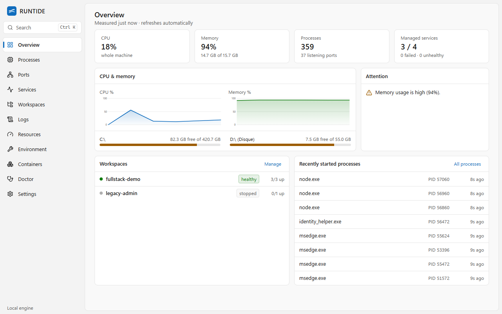
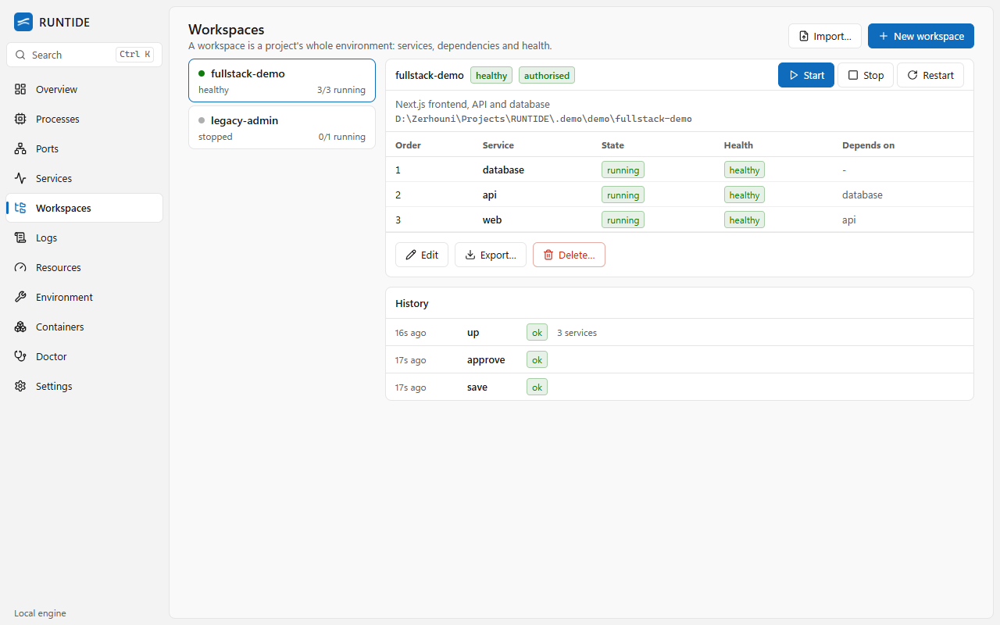
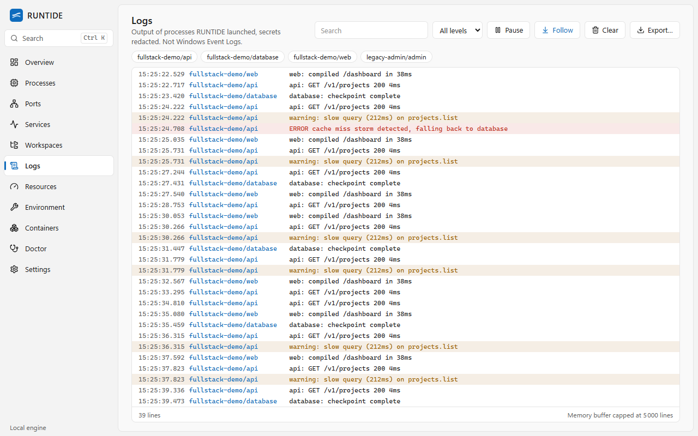
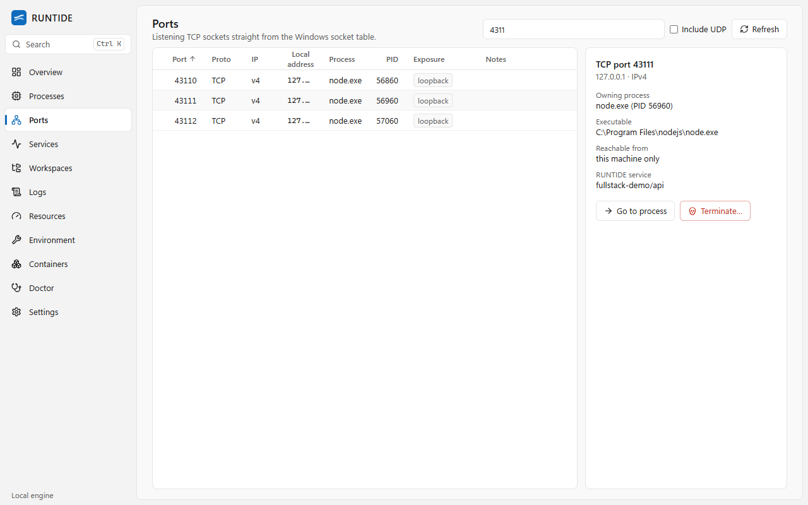
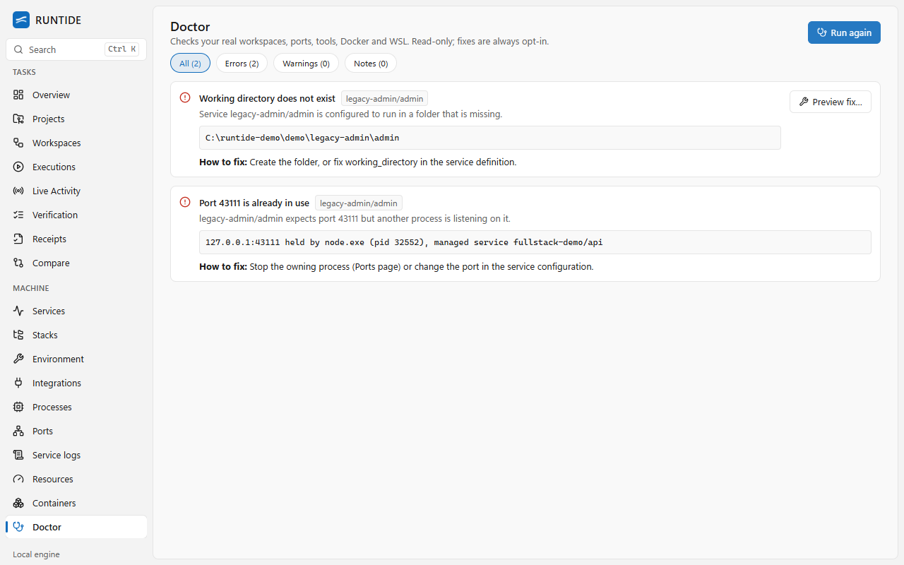

# RUNTIDE

**Everything running. Under control.**

RUNTIDE is a local-first control center for everything running on your Windows development machine: processes,
listening ports, dev services, multi-service workspaces, logs, health, environment files and diagnostics. One
native desktop app and one scriptable CLI share the same engine. No cloud account, no telemetry, no network calls.



> Screenshots are captured from the running application against a real demo workspace (`tests/e2e/screenshots.spec.ts`).
> RUNTIDE is early software (0.1.0). See [Status](#status) for what is and is not finished.

## Why

A typical dev machine runs a Next.js server, a Laravel API, MySQL, Redis, a queue worker, a few containers and a
WSL distro, spread over terminals and tools. RUNTIDE answers: *what is running, who owns port 3000, why did my server
fail, what depends on what, and how do I start the whole project in the right order?*

## Features

* **Overview**: measured CPU, memory, disks, process/port counts, service and workspace health, real warnings.
* **Process Explorer**: every process with PID/parent, path, command line, CPU, memory, start time, tree view,
  search/sort. Termination needs confirmation, refuses protected Windows processes, never elevates and only reports
  success when Windows confirms the process is gone.
* **Port Manager**: listening TCP (and optional UDP) sockets read from the Windows socket tables, IPv4/IPv6,
  owner process, exposure (loopback vs all interfaces), shared-port conflicts, jump to process.
* **Services**: supervised dev processes in Windows Job Objects (whole tree stops together, nothing orphaned),
  graceful stop then forced, restart policies with back-off and a hard retry cap, run history.
* **Workspaces**: define a project's services, dependencies and health checks in YAML; dependency-ordered start,
  reverse-ordered stop, rollback on failure, explicit authorisation before anything runs.
* **Logs**: live stdout/stderr with search, levels, pause, follow, export, bounded memory buffer, SQLite history and
  secret redaction.
* **Health checks**: HTTP, TCP, process, custom command; start period and failure threshold. A live process alone is
  never reported healthy.
* **Resources**: CPU/memory history and disks with a configurable sampling interval.
* **Environment**: detects Node, npm, pnpm, Yarn, PHP, Composer, Python, Java, Go, Git, Docker, WSL, MySQL/PostgreSQL
  clients by running them; inspects `.env` files with redacted values, diffs, `.env.example` generation with backups.
* **Doctor** (`runtide doctor`): port conflicts, missing executables, bad paths, missing env variables, failed or
  unhealthy services, runtime versions, unreachable local databases, Docker/WSL. Fixes are opt-in and previewed.
* **Docker / WSL / Windows services**: optional integrations, kept separate from managed services.
* **Desktop integration**: tray icon, minimise to tray, native notifications, opt-in start with Windows.
* **Command palette** (`Ctrl+K`), light and dark themes, keyboard navigation (`Ctrl+1..9`).

| | |
| --- | --- |
|  |  |
|  |  |

Dark theme: [overview](docs/screenshots/overview-dark.png). More: [processes](docs/screenshots/processes.png),
[services](docs/screenshots/services.png), [resources](docs/screenshots/resources.png),
[environment](docs/screenshots/environment.png), [native window](docs/screenshots/desktop-window.png).

## Supported systems

Windows 10 (22H2+) and Windows 11, x64. Developed and tested on Windows 11 Pro (10.0.26200). Linux and macOS are
future goals; Win32 code is isolated in `internal/platform/windows`. The desktop app needs the WebView2 runtime
(preinstalled on Windows 11 and current Windows 10).

## Install

See [docs/INSTALLATION.md](docs/INSTALLATION.md). Short version: unzip the portable build anywhere or run the
per-user installer (no administrator rights).

## Use

```powershell
runtide status                      # machine and services at a glance
runtide ports 3000                  # who owns port 3000?
runtide ps node --cmdline           # processes with command lines
runtide workspace import .\runtide.yaml
runtide workspace up my-project     # shows commands, asks once, starts in dependency order
runtide logs my-project/api -f      # live logs
runtide doctor                      # what is wrong with my setup?
runtide env inspect                 # .env problems, secrets masked
runtide tools                       # installed runtimes and versions
```

Full reference: [docs/CLI_REFERENCE.md](docs/CLI_REFERENCE.md). Every command supports `--json`.

## Workspace example

```yaml
name: my-fullstack-project
services:
  - name: db
    command: docker
    args: [compose, up, db]
    healthcheck: { type: tcp, port: 3306 }
  - name: backend
    type: laravel
    command: php
    args: [artisan, serve]
    working_directory: backend
    depends_on: [db]
    healthcheck: { type: http, url: "http://localhost:8000" }
    restart: { policy: on-failure, max_retries: 3 }
  - name: frontend
    type: nextjs
    command: npm
    args: [run, dev]
    working_directory: frontend
    depends_on: [backend]
    healthcheck: { type: http, url: "http://localhost:3000" }
```

See [docs/WORKSPACES.md](docs/WORKSPACES.md) for the complete schema and execution model.

## Architecture

Go engine (Win32 via `golang.org/x/sys`), SQLite (pure Go), Wails + React/TypeScript/Tailwind UI, cobra CLI. The
desktop app, CLI and loopback API all call one `Dispatch` function. Details in
[docs/ARCHITECTURE.md](docs/ARCHITECTURE.md).

## Security

Local only, no telemetry, never elevates, no shell interpolation, imported workspaces are validated and need explicit
approval, secrets are redacted, the local API is loopback + token + origin/host checks. See
[docs/SECURITY_MODEL.md](docs/SECURITY_MODEL.md) and [SECURITY.md](SECURITY.md).

## Status

Implemented and tested: everything listed under Features. Known gaps (also in
[docs/DEVELOPMENT_PROGRESS.md](docs/DEVELOPMENT_PROGRESS.md)):

* No per-interface network throughput counters.
* Graceful stop reaches console processes only; GUI processes are force-terminated after the grace period.
* Binaries are unsigned (SmartScreen will warn).
* The product name has not been legally cleared; see the progress document.

## Roadmap

Linux/macOS ports of the platform layer, code signing, winget/Scoop packages, log shipping to files, Compose-aware
workspace start, per-service resource graphs, plugin-style tool detectors.

## Contributing

See [CONTRIBUTING.md](CONTRIBUTING.md). Good first issues are listed in
[docs/FIRST_CONTRIBUTIONS.md](docs/FIRST_CONTRIBUTIONS.md).

## License

MIT, see [LICENSE](LICENSE).
